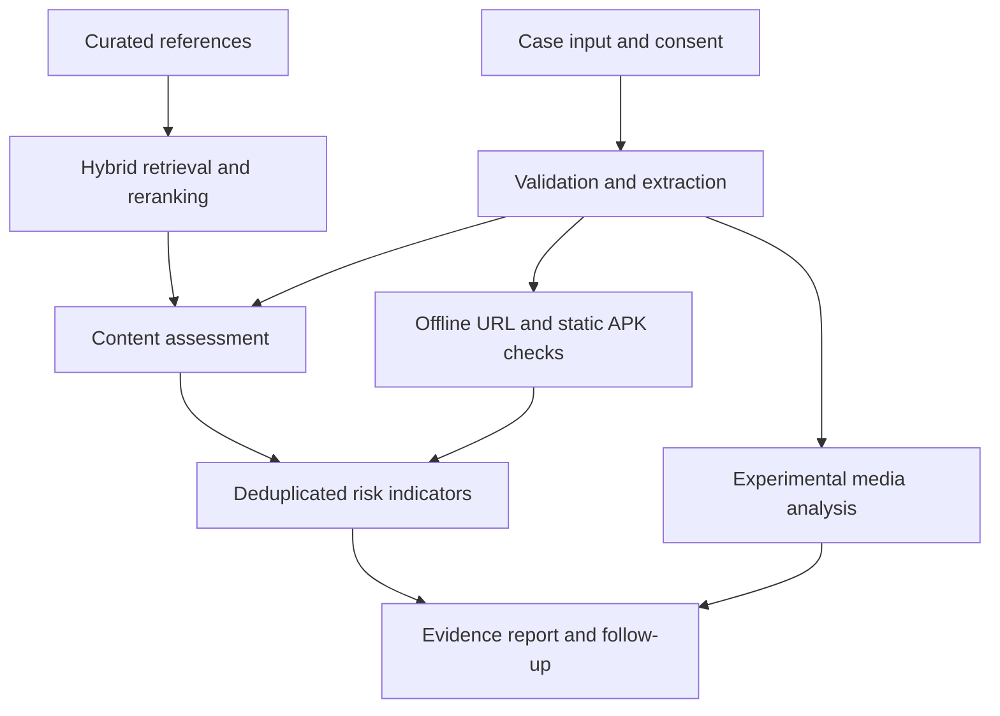

# RIDSca(Risk Intelligence & Detection for Scams)

RIDSca helps people review suspicious financial communications before making a payment, sharing credentials, or installing an application. It brings messages, documents, links, QR codes, media, and APK metadata into a single case, then presents the warning signs, supporting evidence, and practical next steps.

Built with **Streamlit** and **locally hosted open-weight models**, RIDSca provides a transparent analysis workflow with no required paid inference API. Docker packaging and deployment automation are included for **Hugging Face Spaces**.

[Quick start](#quick-start) · [Capabilities](#capabilities) · [Architecture](#architecture) · [Models](#models) · [Deployment](#deployment) · [Documentation](#documentation)

> **Project status:** Research prototype for controlled evaluation. Core application flows and local model integrations have been tested. Risk scores are preliminary, media detectors are experimental, and the system does not certify that a communication is safe or authentic.

## Why RIDSca?

A suspicious request rarely arrives as a single piece of evidence. A message may contain a payment link, refer to a voice note, and ask the recipient to install an app. RIDSca examines these inputs together while keeping the source and limitations of each finding visible.

The application follows three principles:

- **Show the evidence.** Explain which input raised a concern and what was observed.
- **Separate risk from authenticity.** Synthetic media alone does not establish fraudulent intent.
- **Make uncertainty explicit.** Missing models, incomplete checks, and insufficient evidence remain visible in the result.

## Capabilities

| Area | Current implementation |
| :--- | :--- |
| Case intake | Combine a message and related attachments, with consent and upload limits |
| Document analysis | Extract text from PDF, DOCX, PPTX, HTML, JSON, TXT, and Markdown |
| Image text and QR codes | English/Hindi OCR with Tesseract and QR decoding with OpenCV |
| Content assessment | Transparent warning rules and guarded, structured local-model analysis |
| Reference retrieval | BM25 and multilingual embeddings, reciprocal-rank fusion, and cross-encoder reranking |
| URL checks | Offline URL inspection and optional exact-match local reputation lookup |
| APK checks | SHA-256 hashing, static manifest/permission inspection, and optional metadata lookup |
| Media analysis | Timestamped transcription, experimental audio/image classification, and sampled video-frame scores |
| Evidence review | Risk band, preliminary score, per-input findings, references, and check-coverage status |
| Follow-up assistance | Case-specific answers using checked evidence and vetted response templates |
| Export | Download a structured JSON case report |

**Scope:** Video analysis currently samples individual frames; it does not implement temporal face-swap detection or lip-sync verification. Pixel-level manipulation masks, native mobile share extensions, and live web search are not implemented. See the [complete feature matrix](docs/FEATURES.md).

## Quick start

### 1. Get the source

If you already have the project folder, open a terminal there and skip this step.

```bash
git clone https://github.com/ynyetname/RIDSca.git
cd RIDSca
```

### 2. Create a Python environment

Python **3.11** is recommended. Python **3.12** is also supported.

```bash
conda create -n ridsca python=3.11 -y
conda activate ridsca
```

If the environment already exists, only run `conda activate ridsca`.

### 3. Install and launch

Run these commands from the directory containing `app.py`:

```bash
python -m pip install -r requirements.txt
python -m streamlit run app.py
```

Open **[http://localhost:7860](http://localhost:7860)**.

With no configuration overrides, the application starts in **baseline mode**, which does not download AI models. OCR, media-container inspection, and APK manifest parsing require their respective system tools; unavailable checks are reported in the interface.

### Runtime modes

| Mode | Behavior | Intended use |
| :--- | :--- | :--- |
| `baseline` | Parsing, warning rules, BM25 retrieval, offline URL checks, and available static tools | First launch, UI exploration, development, and offline tests |
| `local` | Adds local LLM analysis, model guardrails, dense retrieval, reranking, transcription, and media classifiers | Full prototype evaluation |

## Run with Docker

The Docker configuration includes the Python model runtimes, FFmpeg, English/Hindi Tesseract, and `aapt`.

```bash
docker compose up --build
```

The container defaults to `local` mode. Model weights download on first use and are cached in a Docker volume. Plan for approximately **16 GB of system RAM** and **15 GB of available disk space**; these are planning estimates, not measured minimum requirements.

To launch in baseline mode from PowerShell:

```powershell
$env:RIDSCA_MODE="baseline"
docker compose up --build
```

To switch back:

```powershell
$env:RIDSCA_MODE="local"
docker compose up --build
```

On Linux/macOS, use `RIDSCA_MODE=baseline docker compose up --build`.

> Docker configuration is provided, but an image build was not executed in the original validation environment. See the [build report](docs/BUILD_REPORT.md) for the exact verification scope.

## Enable local models without Docker

For the complete Windows setup, Docker Desktop or WSL2 simplifies installation of the native tools and compiler dependencies.

On Debian/Ubuntu or Ubuntu under WSL2:

```bash
sudo apt-get update
sudo apt-get install -y build-essential cmake ffmpeg tesseract-ocr tesseract-ocr-eng tesseract-ocr-hin aapt

python -m pip install torch==2.8.0 --index-url https://download.pytorch.org/whl/cpu
CC=gcc CXX=g++ CMAKE_ARGS="-DGGML_NATIVE=OFF -DGGML_OPENMP=ON" python -m pip install -r requirements-models.txt

cp .env.example .env
python scripts/doctor.py
python -m streamlit run app.py
```

The example environment sets `RIDSCA_MODE=local`. Native Windows installation of `llama-cpp-python` requires a compatible C++ toolchain; the Bash commands above are intended for Linux/WSL2.

To download the pinned default model weights before launching:

```bash
python scripts/download_models.py
```

Use `--text-only` to omit the image, audio, and transcription models. Weights are downloaded from Hugging Face and are not included in this repository.

## Using the application

1. **Add the communication.** Paste a message or link and attach related files. Built-in examples are available for a quick demonstration.
2. **Confirm consent.** Submit only content you have permission to process.
3. **Analyze the case.** Review the preliminary assessment and the status of each check.
4. **Inspect the evidence.** Explore warning signs, media results, references, and recommended next steps.
5. **Follow up.** Ask about the current case, add context and reanalyze, or export the JSON report.
6. **Clear the session.** Use **Clear case and uploads** when finished.

### Input limits

| Input | Limit |
| :--- | :--- |
| Typed message | 16,000 characters |
| Attachments | Up to 5 files; 20 MiB per file; 40 MiB combined |
| PDF extraction | First 20 pages; scanned-page OCR is not implemented |
| PPTX extraction | Text boxes from the first 30 slides |
| Images | Up to 16 megapixels |
| Audio/video analysis | First 120 seconds |
| Video frame sampling | Up to 6 frames |

Additional extraction and execution limits are documented in [Architecture](docs/ARCHITECTURE.md). Legacy `.ppt` files are not supported; use `.pptx`.

## Architecture



The Streamlit interface calls a shared analysis service. Files are parsed in short-lived subprocesses, while model instances are loaded lazily and reused. A process-level lock limits the instance to one active analysis at a time.

Risk indicators are deduplicated by category across related inputs. Media classifier outputs remain separate from the financial scam-risk score. Follow-up responses use existing case evidence and constrained response templates.

Read the [architecture reference](docs/ARCHITECTURE.md) for component boundaries, contracts, and resource limits.

## Models

| Task | Default model or method |
| :--- | :--- |
| Contextual assessment, evidence audit, and ambiguous follow-up routing | `Qwen/Qwen3-4B-GGUF` — Q4_K_M |
| Prompt-injection screening | `protectai/deberta-v3-base-prompt-injection-v2` and backend rules |
| Dense retrieval | `intfloat/multilingual-e5-small` |
| Reranking | `cross-encoder/mmarco-mMiniLMv2-L12-H384-v1` |
| Speech recognition | Whisper `small` through `faster-whisper`, int8 CPU |
| Audio synthetic-content classification | `mo-thecreator/Deepfake-audio-detection` |
| Image and sampled-frame classification | `dima806/ai_vs_real_image_detection` |
| OCR and QR extraction | Tesseract `eng+hin` and OpenCV |

Model revisions are recorded in [`data/models.lock.json`](data/models.lock.json). These choices balance CPU feasibility, language coverage, and licensing; they are not a claim of best-in-class detection accuracy.

The injection classifier is English-focused, its upstream project is archived, and false positives were observed during testing. When it blocks semantic analysis, the application exposes that limitation and retains available rule-based findings. Model audits can also misinterpret evidence.

See [Model decisions and licenses](docs/MODELS.md) for checkpoint details and limitations.

## Understanding the results

| Result | Interpretation |
| :--- | :--- |
| Low risk: 0–39 | Available positive indicators have a low combined weight |
| Suspicious: 40–69 | Indicators warrant independent verification |
| High risk: 70–100 | Strong or combined warning indicators were detected |
| Inconclusive | No supported positive indicator was established by the available checks |

The numeric score is a **hand-weighted triage indicator**, not a probability of fraud. Missing findings or reputation records do not establish safety. A low score does not verify the sender, website, application, or transaction.

Media values are raw, uncalibrated classifier outputs. They do not measure the percentage of a file created by AI, and they do not independently increase the scam-risk score.

## Configuration

Copy `.env.example` to `.env` and adjust the variables for your environment.

| Variable | Purpose |
| :--- | :--- |
| `RIDSCA_MODE` | Select `baseline` or `local` |
| `RIDSCA_THREADS` | CPU thread budget for model execution |
| `RIDSCA_LLM_REPO` / `RIDSCA_LLM_FILE` | Select a compatible Qwen GGUF checkpoint |
| `RIDSCA_URL_INDEX` | Path to an optional local URL reputation CSV |
| `RIDSCA_APK_INDEX` | Path to an optional APK metadata SQLite database |
| `RIDSCA_SESSION_TTL` | Idle case expiry interval in seconds |
| `HF_TOKEN` | Optional Hub download authentication; required by the deployment script |

Default-model changes should be accompanied by compatibility and integration testing. Keep credentials in environment variables or platform secrets, not in committed files.

### Optional threat-intelligence indexes

**URLs:** Supply an authorized CSV at `local_data/url_reputation.csv`, with the columns `url,verdict,source,observed_at`. Only an exact match marked `malicious` adds a known-threat indicator. Submitted URLs are never automatically visited or expanded.

**APKs:** Import an authorized metadata CSV, including supported AndroZoo-format records:

```bash
python scripts/import_apk_metadata.py /path/to/authorized.csv
```

The importer creates a local SQLite index. It does not download or execute APKs. Bundled example records are synthetic fixtures and are not loaded as live threat intelligence.

## Deployment

RIDSca is configured for a **Hugging Face Docker Space**. Keep the YAML configuration at the top of this README: it declares the Docker SDK and application port `7860`.

### Deploy from your machine

Set `HF_TOKEN` securely to an appropriately scoped Hugging Face write token, then run:

```bash
python scripts/deploy_hf.py YOUR_HF_USERNAME/ridsca --dry-run
python scripts/deploy_hf.py YOUR_HF_USERNAME/ridsca
```

The script creates a private Space by default and uploads an allowlist of source files. Secrets, local case data, model weights, and local reputation indexes are excluded. It does not upgrade hardware or change an existing Space's visibility. A successful upload still requires a successful platform build and runtime check.

### Deploy through GitHub Actions

1. Add the repository secret **`HF_TOKEN`**.
2. Add the repository variable **`HF_SPACE_ID`**, such as `YOUR_HF_USERNAME/ridsca`.
3. Create the GitHub environment **`huggingface`**.
4. Run **Deploy to Hugging Face** from the Actions tab.
5. Review the Space build logs and test a synthetic case after startup.

Deployment is manually triggered. CI runs separately on pushes and pull requests.

**Hosting costs:** Local inference requires no paid API. Hosting eligibility, subscriptions, and hardware charges are separate; consult the [current Hugging Face documentation](https://huggingface.co/docs/hub/en/spaces-overview) before deployment. A free hosted runtime is not guaranteed.

Further guidance is available in the [deployment runbook](docs/DEPLOYMENT.md).

## Testing and validation

Install the development dependencies and run the offline suite:

```bash
python -m pip install -r requirements-dev.txt
python -m ruff check .
python -m pytest -q -m "not models"
```

After installing the model dependencies, opt into real-model integration tests.

**PowerShell:**

```powershell
$env:RIDSCA_MODE="local"
$env:RUN_MODEL_TESTS="1"
python -m pytest tests/test_models_integration.py -v
```

**Linux/WSL2:**

```bash
RIDSCA_MODE=local RUN_MODEL_TESTS=1 python -m pytest tests/test_models_integration.py -v
```

Run the synthetic evaluation fixture:

```bash
python scripts/evaluate.py --dataset data/evaluation_smoke.jsonl
```

### Recorded verification

| Check | Recorded outcome |
| :--- | :--- |
| Offline, parser, deployment-filter, and Streamlit UI tests | 57 passed |
| Real local-model integration tests | 7 passed |
| Ruff static analysis | Passed |
| Streamlit HTTP health check | HTTP 200 |
| Docker build and hosted deployment | Not executed in the original validation environment |

These results describe the recorded build, not a live CI status. Synthetic fixtures and inference smoke tests establish software behavior, not real-world detection accuracy. See the [build report](docs/BUILD_REPORT.md) and [validation methodology](docs/VALIDATION.md).

## Repository guide

| Location | Responsibility |
| :--- | :--- |
| `app.py` | Streamlit interface, session state, reports, and chat |
| `ridsca/service.py` | Case orchestration and model access coordination |
| `ridsca/schema.py` / `config.py` | Typed contracts and application settings |
| `ridsca/parsing.py` / `parser_worker.py` | Validation and bounded extraction |
| `ridsca/models.py` / `retrieval.py` | Model inference, retrieval, and reranking |
| `ridsca/rules.py` / `guardrails.py` / `fusion.py` | Indicators, safeguards, and risk aggregation |
| `ridsca/urls.py` / `apk.py` / `media.py` | Input-specific analysis |
| `scripts/` | Diagnostics, CLI analysis, downloads, evaluation, and deployment |
| `data/` | Curated references, model revisions, and synthetic fixtures |
| `tests/` | Offline and opt-in model test suites |
| `docs/` | Architecture, deployment, scope, and validation references |
| `.github/workflows/` | CI and manual deployment automation |

## Privacy and security

- Analysis runs on the machine or server hosting RIDSca. A hosted instance does not mean processing occurs on the user's device.
- Cases remain in session memory. Temporary processing files are removed after use; no persistent case database or training collection is implemented.
- Idle case expiry is enforced on the next interaction. Streamlit's disconnected-session timeout is configured to 60 seconds.
- Exported reports contain best-effort redacted excerpts and metadata; review them before sharing.
- Uploaded APKs are not installed or executed. Submitted URLs are not fetched.

Resource limits, guardrails, and subprocesses provide defense in depth, not a complete hostile-file sandbox. Public-service authentication, distributed rate limiting, and production isolation are outside the current scope. Use a private deployment for a controlled pilot and review [SECURITY.md](SECURITY.md).

## Documentation

- [Architecture and execution limits](docs/ARCHITECTURE.md)
- [Implemented features and research gaps](docs/FEATURES.md)
- [Model selection and licenses](docs/MODELS.md)
- [Deployment and troubleshooting](docs/DEPLOYMENT.md)
- [Evaluation methodology](docs/VALIDATION.md)
- [Recorded build verification](docs/BUILD_REPORT.md)

## Contributing

Contributions that improve extraction quality, multilingual coverage, test cases, documentation, or evaluation are welcome. For substantial changes, open an issue describing the problem and proposed approach before submitting a pull request.

Include relevant tests with behavioral changes, run the offline suite, and document model or configuration changes. Use synthetic or appropriately consented examples; keep credentials and personal financial information out of issues and commits. Report security concerns privately when a repository security channel is available.

## License and acknowledgments

Application code is released under the [MIT License](LICENSE). Model weights, dependencies, and external reference material retain their respective licenses; see [NOTICE.md](NOTICE.md) and [Model decisions](docs/MODELS.md).

**Project concept: Team SCAMURAI · IIT Roorkee.**

RIDSca builds on the work of the open-model and open-source communities, including Qwen, Hugging Face, Streamlit, Sentence Transformers, Whisper, Tesseract, OpenCV, and the publishers of the specialist detection checkpoints.
