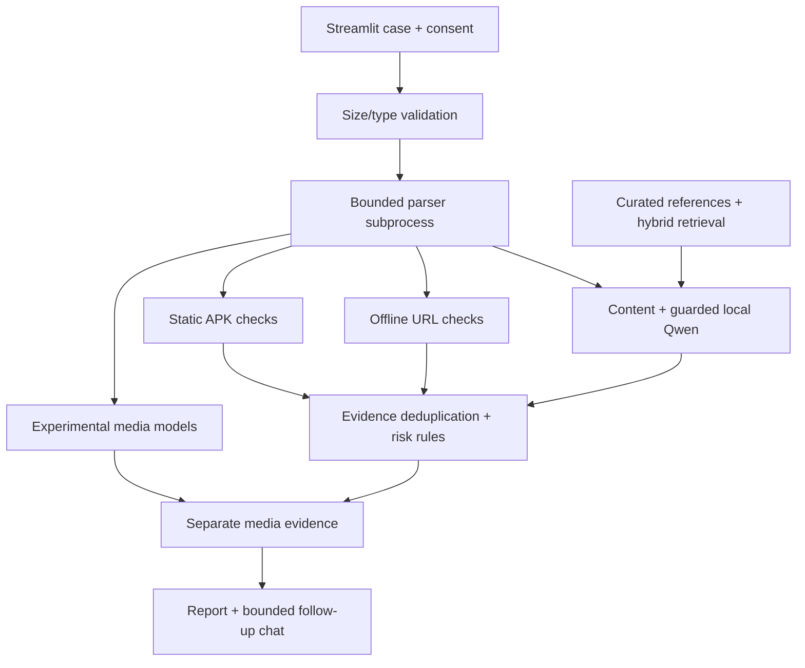

# Architecture and contracts

`Analyzer` has immutable public references, lazy model objects and one lock.
It does not store a case. The Streamlit session owns its `Report`, uploads and
chat. `st.cache_resource` caches the shared analyzer only, never analysis results.
Each case receives a UUID; no history survives process restart.

## Execution and limits

- At most 5 files, 20 MiB each, 40 MiB combined; 16,000 typed characters.
- At most 16,000 extracted characters per document and 48,000 per case.
- PDF: 20 pages. PPTX: 30 slides. Image: 16 million pixels.
- Archive expansion: 80 MiB, 5,000 members, compression-ratio check.
- Media container must be locally decodable; first 120 seconds analyzed.
- Parser process: 50-second wall limit, Linux CPU/file/descriptor limits.
- OCR: 15 seconds; media decoder: bounded stream/duration and subprocess timeout.
- Qwen: 8,192-token context; bounded input, 500 output tokens, 90-second
  token-generation stopping condition. Model loading and prompt prefill are not
  hard-cancelled by that token condition.
- One active analysis per process. Concurrent users receive busy/retry status.
  UI has a 5-second submission debounce, not an abuse-resistant rate limiter.

Model downloads and ASR/classifier inference do not have a process-wide hard
wall-time limit. For an adversarial public service, move all heavy jobs into
separate resource-constrained workers behind a queue and authentication. The
current implementation is intended for a private pilot.

## Fusion

Each warning category has a fixed hand-selected weight. The maximum weight per
category is added once across inputs, capped at 100. Separate sources remain in
the evidence list. The output labels are proposal thresholds, not calibrated
probabilities. Without supported positive indicators, the result is inconclusive.
Model-generated media scores do not modify financial scam risk.

## Grounded output

The semantic model has six predefined categories. Quotes must exactly occur in
its bounded input; a separate audit can reject them. Common follow-up intents are routed deterministically. Qwen routes other
questions to existing finding IDs or one of six topics. The renderer releases fixed
text and checked evidence, rather than free-form LLM claims. This reduces output
attack surface but limits conversational flexibility.
